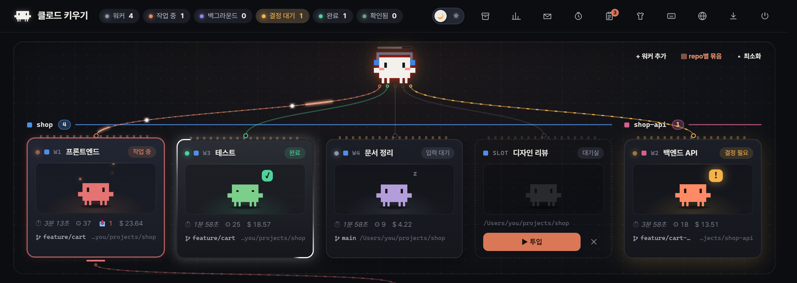
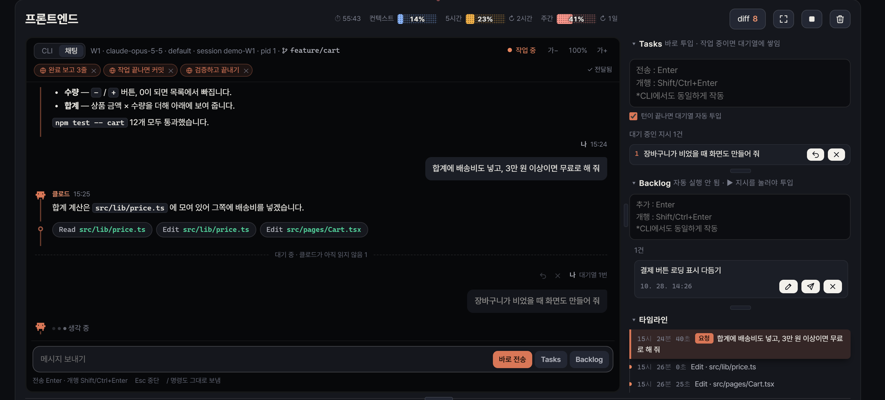
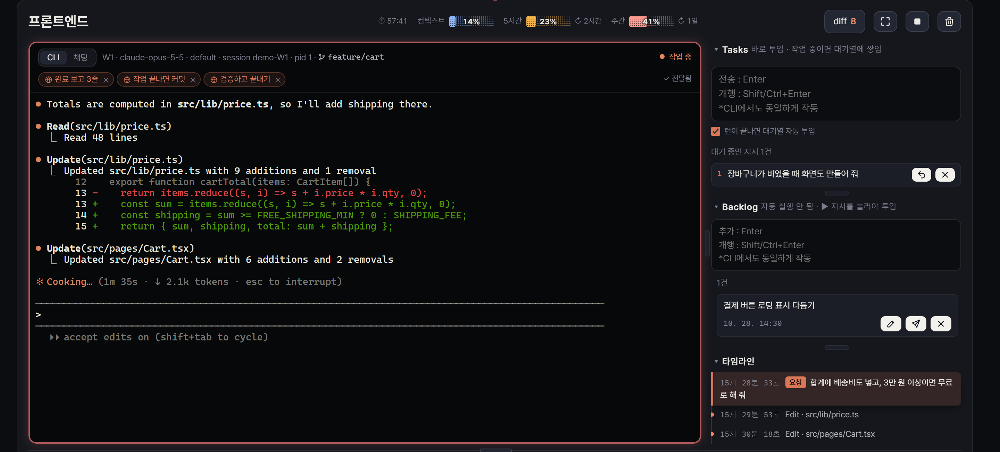
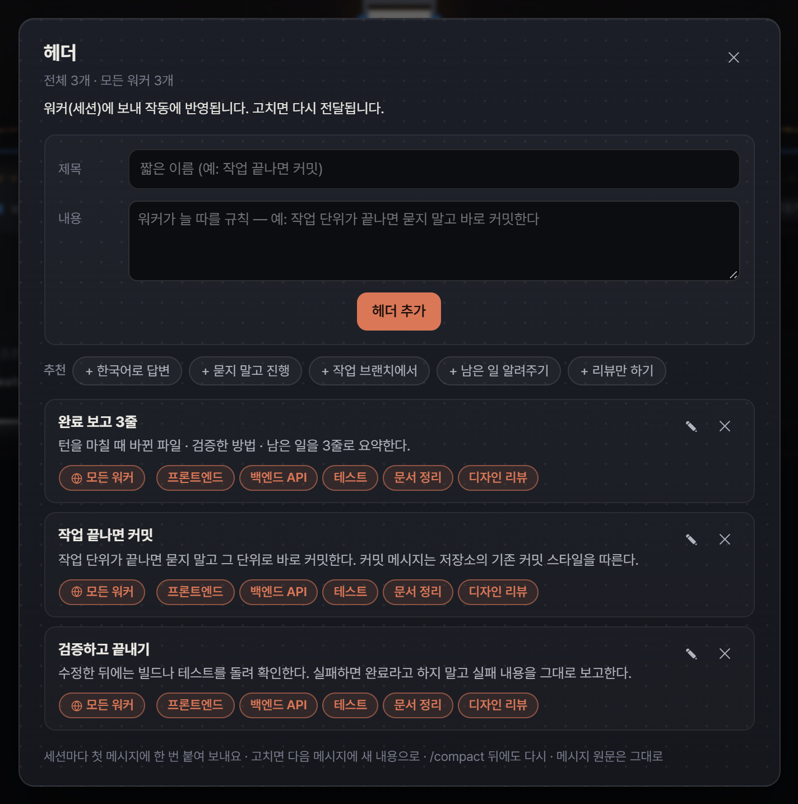
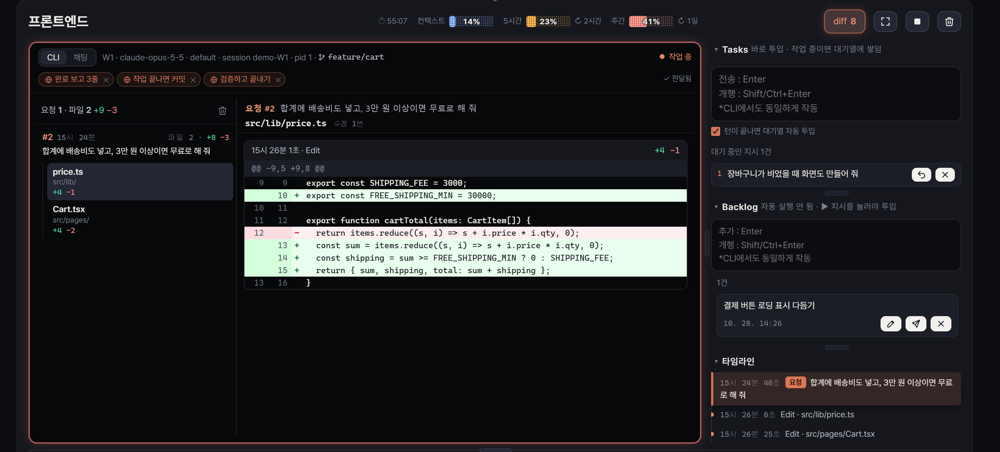
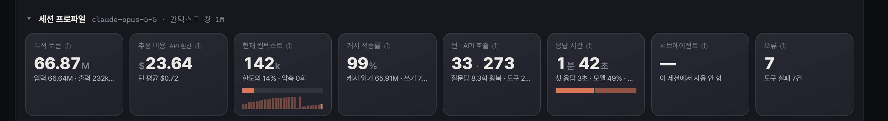
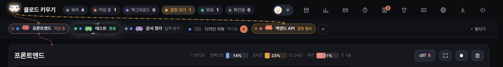

# 클로드 키우기 (agent-manager)

[English](README.md) | **한국어**

내 PC의 **여러 Claude Code 세션(워커)을 브라우저 한 화면에서** 굴리는 대시보드입니다.
일을 나눠 주고, 대화로 지켜보고, 고친 내용과 비용을 확인합니다.



- 워커는 평소 쓰는 `claude` CLI 그대로 — 슬래시 명령·스킬·MCP·설정이 같습니다.
- `127.0.0.1` 에서만 열리는 **내 PC 전용** 도구입니다. 외부 접속은 업데이트 확인뿐입니다.
- 대시보드를 재시작해도 **워커는 끊기지 않고** 다시 붙습니다.

## 설치

준비물: **Node.js 20 이상**, 로그인된 **Claude Code CLI**, Windows 10/11 또는 macOS

```bash
git clone https://github.com/stzjinseong/agent-manager.git
```

클론한 폴더에서 `claude` 를 열고 아래 명령을 입력하면 확인부터 설치까지 대신 해 줍니다.

| | 설치 | 실행 |
|---|---|---|
| macOS | `/setup --mac` | `Launch.app` 또는 터미널에서 `agent-manager` |
| Windows | `/setup --windows` | `Launch.vbs` 또는 PowerShell 에서 `agent-manager` |

> macOS 에서 `Launch.app` 을 처음 열 때 보안 경고가 뜨면 Finder 에서 **우클릭 → 열기**.

## 한눈에 보기

| | |
|---|---|
| **워커 카드** | 상태(작업 중 · 결정 필요 · 완료 · 입력 대기), 비용, git 브랜치. repo 별로 묶여 보입니다 |
| **채팅 보기** | 터미널 대신 대화 형태로 읽고 답합니다. 질문·권한 요청도 카드로 바로 처리 |
| **Tasks · Backlog** | 바로 넣을 지시는 Tasks(작업 중이면 대기열), 나중에 할 일은 Backlog |
| **헤더** | 모든 워커(또는 고른 역할)에 늘 붙여 보낼 규칙 — "작업 끝나면 커밋" 같은 것 |
| **diff** | 워커가 고친 파일을 요청별로. 셸 명령·서브에이전트가 고친 것도 나옵니다 |
| **세션 프로파일** | 토큰 · 추정 비용 · 컨텍스트 · 캐시 적중률 · 도구별 시간 |

## 사용법

### 1. 워커 띄우기

카드 줄 끝의 **워커 추가** 카드를 누르고 역할 이름과 작업 폴더를 정해 **띄우기**.
**역할 저장**을 켜 두면 워커를 닫아도 카드가 **대기실**에 남아 **▶ 투입**으로 다시 띄울 수 있습니다.

### 2. 일 시키고 지켜보기 — 채팅 / CLI

카드를 누르면 아래에 그 워커가 열립니다. 왼쪽 위 **CLI | 채팅** 으로 보기를 바꿉니다.



- 입력칸의 **바로 전송**은 지금 넣고(작업 중이면 도구 하나가 끝날 때), **Tasks** 는 대기열에, **Backlog** 는 메모로 보냅니다.
- 아직 클로드가 읽지 않은 글은 **대기 중** 줄 아래에 흐리게 보이고, 빼거나 Backlog 로 옮길 수 있습니다.
- 답을 마치면 대화 끝에 **✓ 응답 완료**가 붙습니다. **Esc** 로 언제든 중단.
- `/` 로 슬래시 명령 자동 완성, **↑** 로 보낸 글 다시 불러오기.

CLI 로 바꾸면 평소의 Claude Code 터미널 그대로입니다.



권한 승인이 필요하면 카드가 **결정 필요**로 바뀌고 브라우저 탭 아이콘에 점이 뜹니다.

### 3. 늘 붙는 규칙 — 헤더

상단의 📋 **헤더**에서 워커에게 늘 지킬 규칙을 적어 둡니다. 모든 워커 또는 고른 역할에만 붙고,
세션마다 첫 메시지에 한 번 붙여 보냅니다(고치면 다음 메시지에 새 내용으로). 붙은 헤더는 채팅/CLI 막대 아래 칩으로 보입니다.



### 4. 고친 내용 확인 — diff

**diff** 를 누르면 고친 파일을 요청별로 봅니다.



### 5. 토큰·비용 — 세션 프로파일

워커 아래 **세션 프로파일**에 누적 토큰, 추정 비용, 컨텍스트, 캐시 적중률, 도구별 사용량이 나옵니다.
**ⓘ** 에 마우스를 올리면 각 지표의 뜻과 활용법을 알려 줍니다. 상세 위쪽 막대에서는 캐시 만료까지 남은 시간과 계정의 5시간·주간 한도를 봅니다.



### 6. 화면 정리 · 꾸미기

**▴ 최소화**로 카드를 한 줄 칩으로 접습니다. 칩을 누르면 그 워커가 열립니다.



- 👕 **꾸미기** — 캐릭터(직접 그림 올리기 가능) · 테마 · 글꼴 · CLI 색. [테마 만드는 법](themes/README.md)
- ⏱ **예약** — 정한 시각·요일에 역할에게 지시를 넣습니다.
- 📊 **사용 리포트** · 🌐 한국어/English · 🌙/☀ 다크/라이트 · ⬇ 업데이트 알림

## 알아 두기

| 어디서 | 전송 | 줄바꿈 | 그 밖에 |
|---|---|---|---|
| 채팅 입력칸 · Tasks · Backlog | Enter | Shift/Ctrl + Enter | Esc 중단 · `/` 명령 · ↑ 기록 |
| 터미널(CLI) | Enter | Shift/Ctrl + Enter | Ctrl+C: 선택한 글이 있으면 복사, 없으면 중단 |

- 파일·이미지는 입력칸이나 터미널에 끌어다 놓거나 붙여 넣으면 첨부됩니다.
- **⏻** 로 서버만 끄거나(워커는 계속 실행) 워커까지 함께 끌 수 있습니다. 업데이트 뒤엔 **↻ 지금 재시작** — 워커는 그대로입니다.
- 비용은 API 단가로 환산한 추정치입니다. 구독 사용 시 실제 청구액과 다릅니다.
- Chrome 에 맞춰 만들었습니다. 다른 브라우저면 헤더에 **⚠** 가 뜨고, 누르면 Chrome 으로 열립니다.
