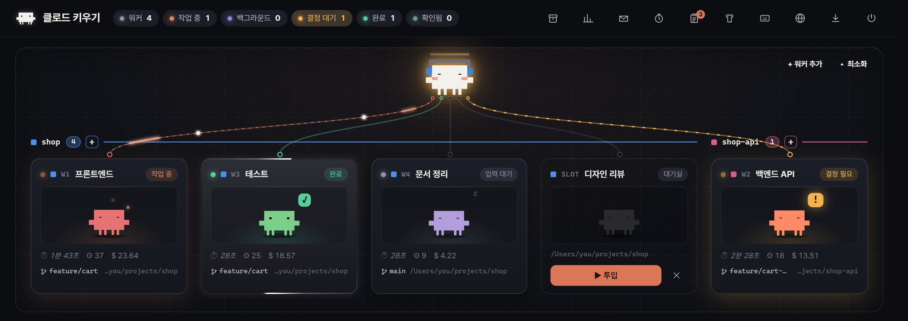
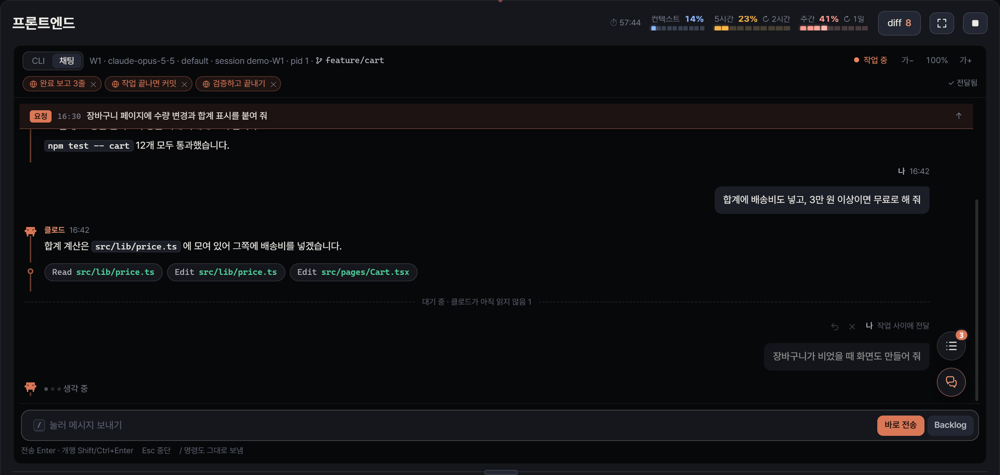
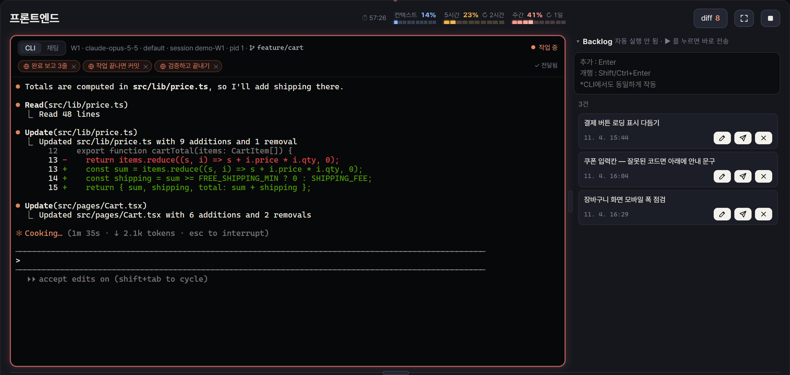
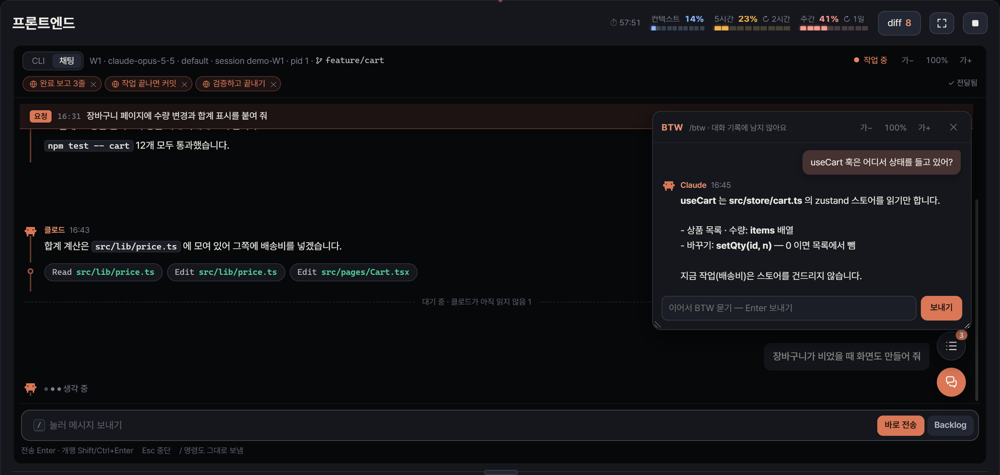
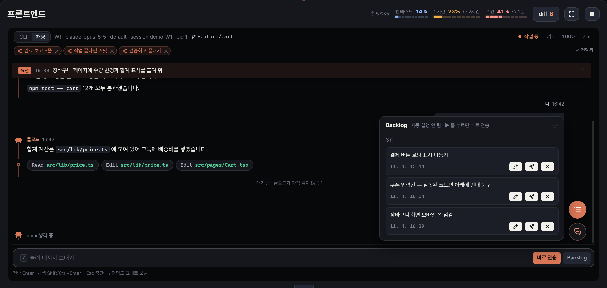
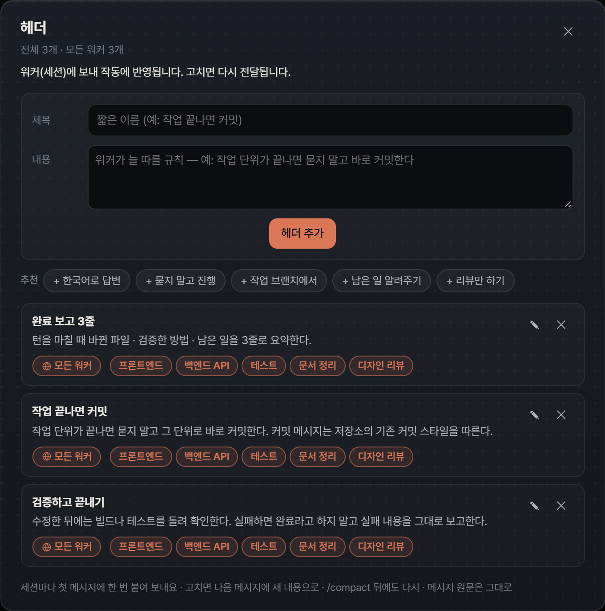
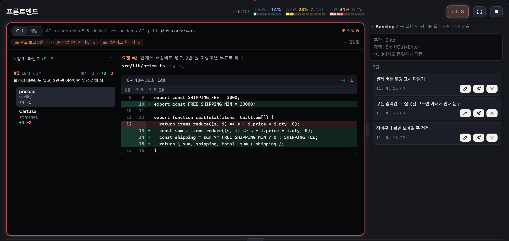
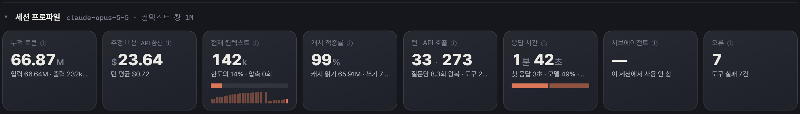
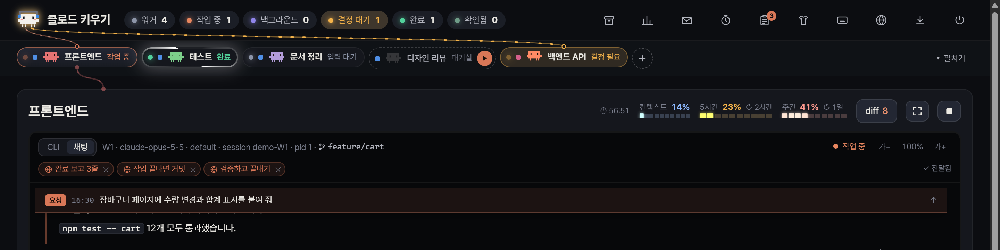

# 클로드 키우기 (agent-manager)

[English](README.md) | **한국어**

내 PC의 **여러 Claude Code 세션(워커)을 브라우저 한 화면에서** 굴리는 대시보드입니다.
일을 나눠 주고, 대화로 지켜보고, 고친 내용과 비용을 확인합니다.



- 워커는 평소 쓰는 `claude` CLI 그대로입니다 — 슬래시 명령 · 스킬 · MCP · 설정이 같습니다.
- `127.0.0.1` 에서만 열리는 **내 PC 전용** 도구입니다. 외부 접속은 업데이트 확인뿐입니다.
- 대시보드를 재시작해도 **워커는 끊기지 않고** 다시 붙습니다.

## 설치

준비물: **Node.js 20 이상**, 로그인된 **Claude Code CLI**, Windows 10/11 또는 macOS

```bash
git clone https://github.com/stzjinseong/agent-manager.git
```

클론한 폴더에서 `claude` 를 열고 아래 명령을 입력하면 확인부터 설치까지 대신 해 줍니다.

| | 설치 | 실행 |
|---|---|---|
| macOS | `/setup --mac` | `Launch.app` 또는 터미널에서 `agent-manager` |
| Windows | `/setup --windows` | `Launch.vbs` 또는 PowerShell 에서 `agent-manager` |

> macOS 에서 `Launch.app` 을 처음 열 때 보안 경고가 뜨면 Finder 에서 **우클릭 → 열기**.

## 한눈에 보기

| | |
|---|---|
| **워커 카드** | 상태(작업 중 · 결정 필요 · 완료 · 입력 대기), 비용, git 브랜치. 작업 폴더(repo)별로 묶여 보입니다 |
| **채팅 보기** | 터미널 대신 대화 형태로 읽고 답합니다. 권한 요청 · 질문도 카드로 바로 처리 |
| **BTW** | 클로드가 일하는 도중에 곁질문(`/btw`). 답은 따로 뜬 창에, 대화 기록엔 안 남습니다 |
| **Backlog** | 나중에 할 일을 담아 두고 ▶ 한 번으로 보냅니다. 다른 워커로 끌어 옮기기도 됩니다 |
| **헤더** | 모든 워커(또는 고른 역할)에 늘 붙여 보낼 규칙 — "작업 끝나면 커밋" 같은 것 |
| **diff** | 워커가 고친 파일을 요청별로. 셸 명령 · 서브에이전트가 고친 것도 나옵니다 |
| **사용량 · 프로파일** | 컨텍스트 · 5시간 · 주간 한도 막대, 토큰 · 추정 비용 · 캐시 적중률 · 도구별 시간 |

## 사용법

### 1. 워커 띄우기

오른쪽 위 **+ 워커 추가**에서 역할 이름과 작업 폴더를 정해 **띄우기**.
이미 있는 폴더라면 묶음 머리줄의 **+** 로 모델 · 권한만 골라 바로 띄울 수 있습니다.

- 띄웠던 역할은 저장돼, 워커를 닫아도 카드가 **대기실**에 남습니다. **▶ 투입**으로 다시 띄웁니다.
- 카드를 끌면 아래에 놓는 곳이 나옵니다 — **세션만 종료** 또는 **세션 종료 + 카드 제거**.

### 2. 일 시키고 지켜보기 — 채팅 / CLI

카드를 누르면 아래에 그 워커가 열립니다. 왼쪽 위 **CLI | 채팅** 으로 보기를 바꿉니다.



- **바로 전송**은 지금 넣습니다. 클로드가 작업 중이면 도구 하나가 끝나는 틈에 들어가고, 그전까지는 **대기 중** 줄 아래에 보여 빼거나 Backlog 로 옮길 수 있습니다.
- 권한 요청은 대화 끝에 **허락 · 거절 · CLI 에서 고르기** 카드로, 질문은 입력칸 위 카드로 뜹니다. 이때 워커 카드는 **결정 필요**로 바뀌고 브라우저 탭 아이콘에 점이 뜹니다.
- `/` 로 슬래시 명령 자동 완성(목록은 그 워커의 Claude Code 에서 받아 옴), **↑** 로 이 세션에서 보낸 글 다시 불러오기, **Esc** 로 중단.
- 클로드 답에서 글을 고르면 **1 물어보기 · 2 입력칸에 넣기 · 3 복사** 메뉴가 뜹니다(숫자 키로도).
- 위로 스크롤하면 가려진 내 요청이 맨 위에 붙어 있고, 맨 아래가 아니면 입력칸 위에 **↓** 버튼이 뜹니다.
- 답 속 그림(``)과 클로드가 만든 문서 · 캡처는 대화 그 자리에 카드로 보입니다. **가− 100% 가+** 로 글자 크기.
- CLI 에서만 고를 수 있는 화면(`/model` 같은 메뉴 등)이 뜨면 채팅 아래쪽에 실제 터미널이 드러나고 **CLI 가 입력을 기다려요** 막대가 붙습니다.

CLI 로 바꾸면 평소의 Claude Code 터미널 그대로입니다.



### 3. 일하는 도중 곁질문 — BTW

입력칸에 `/btw 질문` 을 보내거나 오른쪽 아래 **말풍선 버튼**을 눌러 묻습니다. 클로드는 하던 일을 멈추지 않고, 답은 따로 뜬 **BTW 창**에 나옵니다.



- 창 안 입력칸으로 이어서 묻고, 머리줄을 끌어 옮기고, 모서리를 끌어 크기를 바꿉니다. 글자 크기는 **가− 100% 가+**.
- BTW 답은 Claude Code 대화 기록에 남지 않습니다(같은 세션 안에서만 보입니다).

### 4. 나중에 할 일 — Backlog

담기: 채팅 입력칸 오른쪽 **Backlog** 버튼, 또는 CLI 보기 오른쪽 패널의 입력칸.
채팅 보기에선 BTW 버튼 위 **목록 버튼**(담긴 개수 표시)을 누르면 Backlog 가 뜹니다.



- ▶ 로 바로 보내고, 연필로 고치고, ✕ 로 지웁니다. 끌어서 순서를 바꾸거나 **다른 워커 카드에 놓아** 그 워커로 옮깁니다.
- Backlog 는 저절로 실행되지 않습니다 — 보낼 때를 직접 고릅니다.

### 5. 늘 붙는 규칙 — 헤더

상단의 📋 **헤더**에서 워커에게 늘 지킬 규칙을 적어 둡니다. 모든 워커 또는 고른 역할에만 붙고,
세션마다 첫 메시지에 한 번 붙여 보냅니다(고치면 다음 메시지에 새 내용으로). 붙은 헤더는 채팅/CLI 막대 아래 칩으로 보입니다.



### 6. 고친 내용 확인 — diff

**diff** 를 누르면 고친 파일을 요청별로 봅니다.



### 7. 토큰 · 비용 — 사용량 막대 · 세션 프로파일

상세 오른쪽 위 막대에서 **컨텍스트**, 계정의 **5시간 · 주간 한도**와 초기화까지 남은 시간, 캐시 만료까지 남은 시간을 봅니다.
워커 아래 **세션 프로파일**엔 누적 토큰, 추정 비용, 캐시 적중률, 도구별 사용량이 나오고, **ⓘ** 에 마우스를 올리면 각 지표의 뜻과 활용법을 알려 줍니다.



### 8. 화면 정리 · 꾸미기

**▴ 최소화**로 카드를 한 줄 칩으로 접습니다. 칩을 누르면 그 워커가 열립니다.



상단 아이콘:

| | |
|---|---|
| 🗃 알림 보관함 | 지나간 알림 다시 보기 |
| 📊 나의 사용 리포트 | 내 토큰 · 비용 사용 내역 |
| ✉ 하루 요약 | 하루치 작업을 카드 한 장으로 |
| ⏱ 예약 실행 | 정한 시각 · 요일에 역할에게 지시를 넣습니다 |
| 📋 헤더 | 위 5번 |
| 👕 꾸미기 | 캐릭터(직접 그림 올리기 가능) · 테마(기본 · 글래스) · 글꼴 · CLI 색. [테마 만드는 법](themes/README.md) |
| ⌨ 전송 · 개행 키 | Enter 와 Shift/Ctrl+Enter 역할 바꾸기 |
| 🌐 언어 | 한국어 / English |
| ⬇ 업데이트 | 클로드 키우기 · Claude Code 새 버전 알림. Claude Code 는 **지금 업데이트**로 터미널에서 `claude update` 를 실행 |
| ⏻ 서버 종료 | 서버만 끄거나(워커는 계속 실행) 워커까지 함께 끄기 |

## 알아 두기

| 어디서 | 전송 | 줄바꿈 | 그 밖에 |
|---|---|---|---|
| 채팅 입력칸 · BTW · Backlog | Enter | Shift/Ctrl + Enter | Esc 중단 · `/` 명령 · ↑ 기록 |
| 터미널(CLI) | Enter | Shift/Ctrl + Enter | Ctrl+C: 선택한 글이 있으면 복사, 없으면 중단 |

- 파일 · 이미지는 입력칸이나 터미널에 끌어다 놓거나 붙여 넣으면 첨부됩니다.
- 워커가 만든 문서 · 캡처 · 보낸 첨부는 상세 위 **파일 탭(결과물 · 캡처 · 입력)** 에도 모입니다. ▾ 로 접고 🗑 로 비웁니다.
- 업데이트 뒤엔 **↻ 지금 재시작** — 워커는 그대로입니다.
- 지금은 다크 화면만 씁니다(라이트는 다시 다듬는 중).
- 비용은 API 단가로 환산한 추정치입니다. 구독 사용 시 실제 청구액과 다릅니다.
- Chrome 에 맞춰 만들었습니다. 다른 브라우저면 헤더에 **⚠** 가 뜨고, 누르면 Chrome 으로 열립니다.
