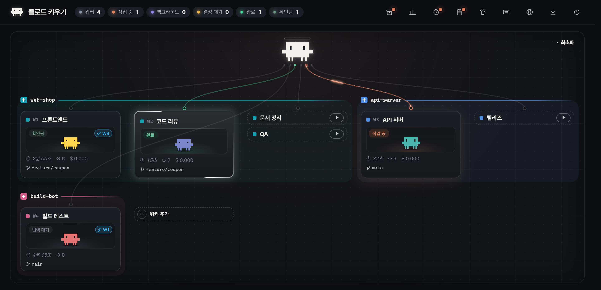
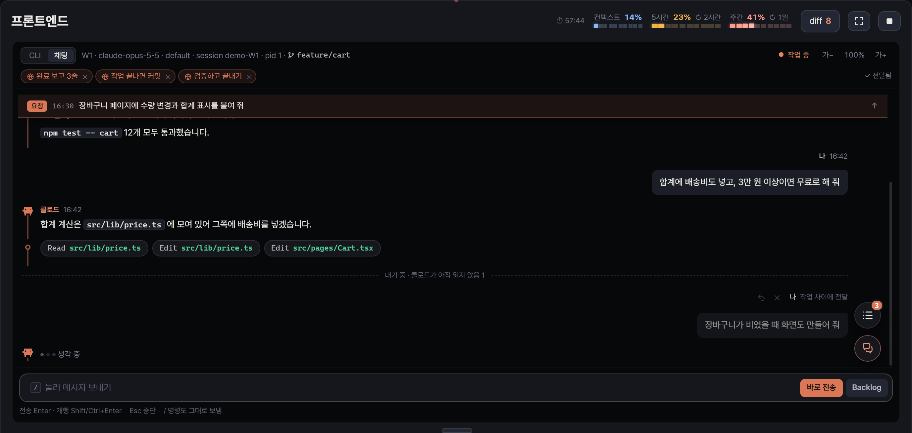
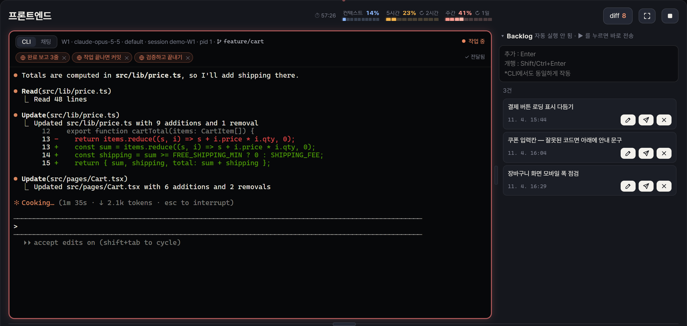
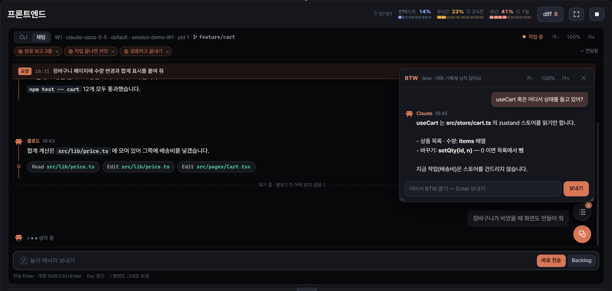
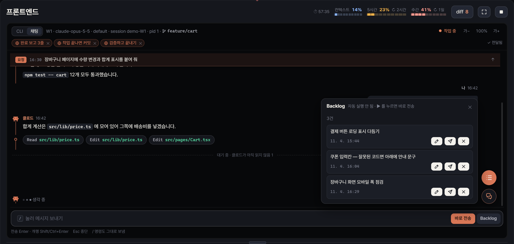
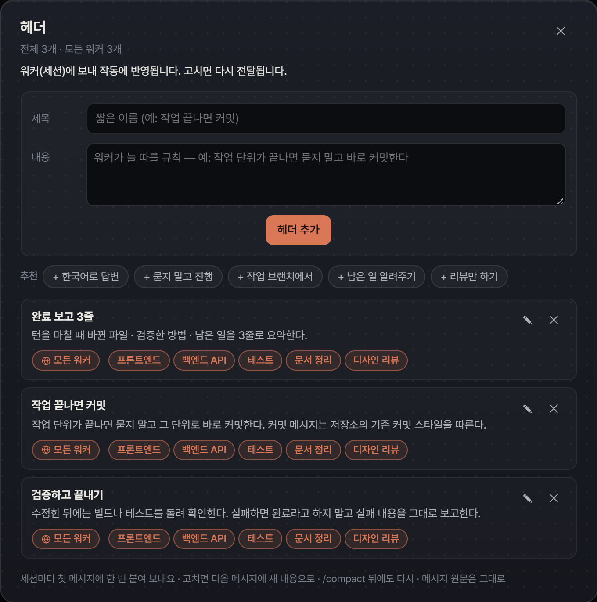
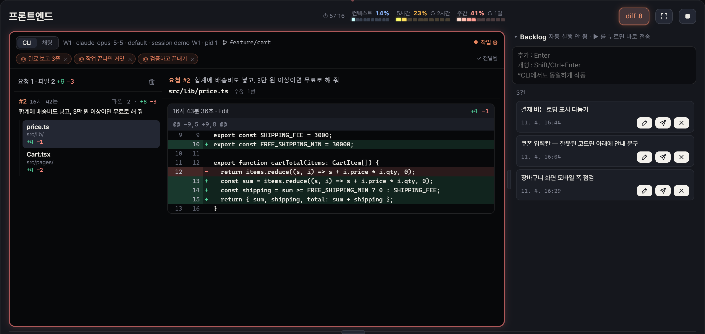
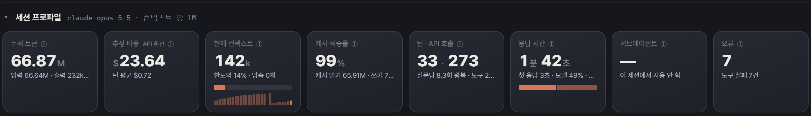
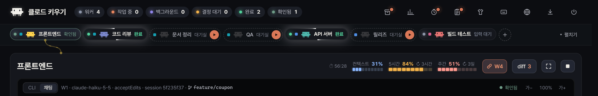

# 클로드 키우기 (agent-manager)

[English](README.md) | **한국어**

내 PC의 **여러 Claude Code 세션(워커)을 브라우저 한 화면에서** 굴리는 대시보드입니다.
일을 나눠 주고, 대화로 지켜보고, 고친 내용과 비용을 확인합니다. 워커끼리 일을 주고받게 이어 줄 수도 있습니다.



- 워커는 평소 쓰는 `claude` CLI 그대로입니다 — 슬래시 명령 · 스킬 · MCP · 설정이 같습니다.
- `127.0.0.1` 에서만 열리는 **내 PC 전용** 도구입니다. 밖으로 나가는 요청은 업데이트 확인(GitHub · npm)과 화면 글꼴(CDN)뿐입니다.
- 대시보드를 재시작해도 **워커는 끊기지 않고** 다시 붙습니다. **서버 + 워커 모두 종료**로 껐다면 다음에 켤 때 켜져 있던 워커를 지난 세션 그대로 다시 띄웁니다.

## 설치

준비물: **Node.js 20 이상**, 로그인된 **Claude Code CLI**, Windows 10/11 또는 macOS

```bash
git clone https://github.com/stzjinseong/agent-manager.git
```

클론한 폴더에서 `claude` 를 열고 아래 명령을 입력하면 확인부터 설치까지 대신 해 줍니다.

| | 설치 | 실행 |
|---|---|---|
| macOS | `/setup --mac` | `Launch.app` 또는 터미널에서 `agent-manager` |
| Windows | `/setup --windows` | `Launch.vbs` 또는 PowerShell 에서 `agent-manager` |

> macOS 에서 `Launch.app` 을 처음 열 때 보안 경고가 뜨면 Finder 에서 **우클릭 → 열기**.

## 한눈에 보기

| | |
|---|---|
| **워커 카드** | 상태(작업 중 · 결정 필요 · 완료 · 입력 대기), 비용, git 브랜치. 작업 폴더(repo)별 상자로 묶여 보입니다 |
| **채팅 보기** | 터미널 대신 대화 형태로 읽고 답합니다. 권한 요청 · 질문 · 계획 승인도 카드로 바로 처리 |
| **BTW** | 클로드가 일하는 도중에 곁질문(`/btw`). 답은 따로 뜬 창에 — 브라우저 밖 별도 창으로도 띄웁니다 |
| **Backlog** | 나중에 할 일을 담아 두고 ▶ 한 번으로 보냅니다. 입력칸에서 **↓** 로 꺼내 다듬어 보내기도 됩니다 |
| **워커 연결 🔗** | 저장소가 다른 워커끼리 일을 맡기고 결과를 돌려받습니다 (예: W1 수정 → W2 빌드 · 테스트 → W1 에 회신) |
| **헤더** | 모든 워커(또는 고른 역할)에 늘 붙여 보낼 규칙 — "작업 끝나면 커밋" 같은 것 |
| **diff** | 워커가 고친 파일을 요청별로. 셸 명령 · 서브에이전트가 고친 것도 나오고, 채팅의 도구 칩을 눌러 그 수정만 볼 수도 있습니다 |
| **사용량 · 프로파일** | 컨텍스트 · 5시간 · 주간 한도 막대, 토큰 · 추정 비용 · 캐시 적중률 · 도구별 시간 |

## 사용법

### 1. 워커 카드 판 보는 법

화면 위쪽 카드 판은 **작업 폴더(repo)별 상자**로 묶입니다. 상자 머리줄에는 repo 색 네모 · 폴더 이름 · **+**(그 폴더에 워커 추가)가 있고, 한 묶음이 줄을 넘치면 마지막 줄 빈칸에 다음 묶음이 이어 채워집니다.

| 카드 | 생김새 |
|---|---|
| **워커 카드** | 머리줄: 번호(W1) · 역할 이름 · **⋯** 메뉴<br>가운데 무대: 캐릭터, 위 가운데 **상태 태그**(작업 중 · 결정 필요 · 완료 · 입력 대기 — 깜빡임도 이 태그가), 오른쪽 위 **짝 칩**(🔗 W2), 왼쪽 아래 최근 **캡처** · 오른쪽 아래 최근 **결과물 문서** 썸네일<br>아래: ⏱ 이번 턴 경과 · ⚙ 도구 횟수 · $ 추정 비용, git 브랜치 |
| **대기실 카드** | 닫힌 역할. 이름과 **▶ 투입**만 있는 한 줄 카드로, 워커 카드 한 칸에 네 장씩 들어갑니다 |
| **워커 추가 카드** | 카드 목록 끝의 한 줄 카드 |

- 확인하지 않은 완료는 카드 테두리가 초록으로 깜빡입니다. 열어 보면 꺼집니다.
- 폴더 경로는 카드에 띄우지 않습니다 — 상자 머리줄이 폴더를 보여 주고, 전체 경로는 카드 아래 줄에 마우스를 올리면 보입니다.
- 컨텍스트 사용량은 카드가 아니라 상세 패널의 미터에서 봅니다(9번).
- 칩 이름을 더블클릭하면 역할 이름을, 카드를 끌면 순서를 바꿉니다.

### 2. 워커 띄우기

카드 목록 끝의 **워커 추가** 카드에서 역할 이름 · 작업 폴더 · 권한 모드를 정해 **띄우기**.
이미 있는 폴더라면 묶음 상자 머리줄의 **+** 로 모델 · 권한만 골라 바로 띄울 수 있습니다.

- 띄웠던 역할은 저장돼, 워커를 닫아도 한 줄짜리 **대기실** 카드로 남습니다. **▶ 투입**은 지난 세션을 이어서, **Shift + ▶** 는 새 세션으로 띄웁니다.
- 카드를 끌면 아래에 놓는 곳이 나옵니다 — **세션만 종료** 또는 **세션 종료 + 카드 제거**. 이름 바꾸기 · 순서 옮기기 · 삭제는 카드의 **⋯** 메뉴에도 있습니다.
- 끝난 워커 기록은 역할마다 최근 3개(30일 이내)만 남기고 저절로 정리됩니다.

### 3. 일 시키고 지켜보기 — 채팅 / CLI

카드를 누르면 아래에 그 워커가 열립니다. 처음엔 **채팅** 보기로 열리고, 왼쪽 위 **CLI | 채팅** 토글을 누를 때마다 바뀝니다.



- **바로 전송**은 지금 넣습니다. 클로드가 작업 중이면 도구 하나가 끝나는 틈에 들어가고, 그전까지는 **대기 중** 줄 아래에 보여 빼거나 Backlog 로 옮길 수 있습니다.
- 권한 요청은 대화 끝에 **허락 · 거절 · CLI 에서 고르기** 카드로, 질문(AskUserQuestion) · 계획 승인은 입력칸 위 카드로 뜹니다. 이때 워커 카드는 **결정 필요**로 바뀌고 브라우저 탭 아이콘에 점이 뜹니다.
- 작업 중엔 **지금 하는 일**(클로드의 마지막 생각)이 보입니다. 서버처럼 계속 도는 백그라운드 명령은 **상주 프로세스**로 따로 표시됩니다.
- 파일을 고친 **도구 칩**(초록 테두리)을 누르면 그 수정의 diff 가 옆 패널로 열립니다.
- 입력칸 단축키: `/` 슬래시 명령 자동 완성(목록은 그 워커의 Claude Code 에서 받아 옴) · **↑** 이 세션에서 보낸 글 목록 · **↓** Backlog 에서 꺼내기 · **Esc** 중단(멈추면 보낸 글이 입력칸으로 돌아옵니다).
- 클로드 답에서 글을 고르면 **1 물어보기 · 2 입력칸에 넣기 · 3 복사** 메뉴가 뜹니다(숫자 키로도).
- 위로 스크롤하면 가려진 내 요청이 맨 위에 붙어 있고, 맨 아래가 아니면 입력칸 위에 **↓** 버튼이 뜹니다.
- 답 속 그림(``)과 클로드가 만든 문서 · 캡처는 대화 그 자리에 카드로 보입니다(작업 폴더 밖 문서도). **가− 100% 가+** 로 글자 크기.
- CLI 에서만 고를 수 있는 화면(`/model` 메뉴 · 처음 여는 폴더의 신뢰 확인 등)이 뜨면 채팅 아래쪽에 실제 터미널이 드러나고 **CLI 가 입력을 기다려요** 막대가 붙습니다.
- 숨겨진 쪽 입력칸에 보내지 않은 글이 있으면 그쪽 토글이 은은히 반짝입니다 — 채팅 보기에선 **CLI** 입력창에 글이 남아 있을 때(드물게 보낸 글이 거기 남아 멈출 때가 있습니다), CLI 보기에선 **채팅** 입력칸에 쓰던 글이 있을 때.

CLI 로 바꾸면 평소의 Claude Code 터미널 그대로입니다.



### 4. 일하는 도중 곁질문 — BTW

입력칸에 `/btw 질문` 을 보내거나 오른쪽 아래 **말풍선 버튼**을 눌러 묻습니다. 클로드는 하던 일을 멈추지 않고, 답은 따로 뜬 **BTW 창**에 나옵니다.



- 창 안 입력칸으로 이어서 묻고, 머리줄을 끌어 옮기고, 모서리를 끌어 크기를 바꿉니다. 글자 크기는 **가− 100% 가+**, **Esc** 로 닫기.
- 머리줄의 **브라우저 밖 창으로 띄우기** 버튼을 누르면 늘 위에 떠 있는 별도 창이 됩니다(Chrome · Edge). 다른 워커로 바꾸면 창도 그 워커를 따라갑니다.
- CLI 가 그린 표는 HTML 표로 바꿔 보여 줍니다.
- BTW 답은 Claude Code 대화 기록에 남지 않습니다(같은 세션 안에서만 보입니다).

### 5. 나중에 할 일 — Backlog

담기: 채팅 입력칸 오른쪽 **Backlog** 버튼, 또는 CLI 보기 오른쪽 패널의 입력칸.
채팅 보기에선 BTW 버튼 위 **목록 버튼**(담긴 개수 표시)을 누르면 Backlog 가 뜹니다.



- ▶ 로 바로 보내고, 연필로 고치고, ✕ 로 지웁니다. 끌어서 순서를 바꾸거나 **다른 워커 카드에 놓아** 그 워커로 옮깁니다.
- 빈 입력칸에서 **↓** 를 누르면 Backlog 목록이 떠서, 고른 항목을 빼서 입력칸에 넣습니다(쓰던 글이 있으면 그 아래 줄에).
- Backlog 는 저절로 실행되지 않습니다 — 보낼 때를 직접 고릅니다.

### 6. 워커끼리 일 주고받기 — 워커 연결 🔗

카드의 **⋯** 메뉴 → **🔗 워커 연결…** 에서 짝 지을 워커를 고릅니다.
연결된 워커에게 "W2 에게 빌드 · 테스트 맡겨" 처럼 말하면, 워커가 직접 상대에게 일을 보내고 상대는 끝난 뒤 결과를 회신합니다.

- 저장소가 달라도 됩니다 — 예: 클라이언트 워커가 고치고, 빌드 머신 저장소의 워커가 풀 · 빌드 · 테스트 후 결과를 돌려줌.
- 카드에 짝 칩(🔗 W2)이 붙고, 마우스를 올리면 짝을 선으로, 주고받을 때는 쪽지가 오가는 모습으로 보여 줍니다.
- 연결은 다음 메시지부터 워커에게 알려집니다. 사람 입력 없이 **12번** 오가면 멈춥니다(끝없는 "확인했습니다" 방지).

### 7. 늘 붙는 규칙 — 헤더

상단의 📋 **헤더**에서 워커에게 늘 지킬 규칙을 적어 둡니다. 모든 워커 또는 고른 역할에만 붙고,
세션마다 첫 메시지에 한 번 붙여 보냅니다(고치면 다음 메시지에 새 내용으로). 붙은 헤더는 채팅/CLI 막대 아래 칩으로 보입니다.



### 8. 고친 내용 확인 — diff

**diff** 를 누르면 고친 파일을 요청별로 봅니다. **가− 100% 가+**(또는 Ctrl + 휠)로 글자 크기를 바꿉니다.



### 9. 토큰 · 비용 — 사용량 막대 · 세션 프로파일

상세 오른쪽 위 막대에서 **컨텍스트**, 계정의 **5시간 · 주간 한도**와 초기화까지 남은 시간, 캐시 만료까지 남은 시간을 봅니다.
워커 아래 **세션 프로파일**엔 누적 토큰, 추정 비용, 캐시 적중률, 도구별 사용량이 나오고, **ⓘ** 에 마우스를 올리면 각 지표의 뜻과 활용법을 알려 줍니다.



> 회사 관리 설정이 상태줄을 정해 둔 PC 에서도 5시간 · 주간 사용량을 받아 옵니다(원래 상태줄 명령은 이어서 실행).

### 10. 화면 정리 · 꾸미기

**▴ 최소화**로 카드를 한 줄 칩으로 접습니다. 칩을 누르면 그 워커가 열립니다.



상단 아이콘:

| | |
|---|---|
| 🗃 알림 보관함 | 지나간 알림 다시 보기 |
| 📊 나의 사용 리포트 | 내 토큰 · 비용 사용 내역(7일 · 30일 · 전체) |
| ✉ 하루 요약 | 하루치 작업을 카드 한 장으로 |
| ⏱ 예약 실행 | 정한 시각 · 매일 · 일정 간격으로 역할에게 지시를 넣습니다. 5시간 한도가 90% 넘으면 건너뜀 |
| 📋 헤더 | 위 7번 |
| 👕 꾸미기 | 캐릭터(직접 그림 올리기 가능) · 테마(기본 · 글래스 · 직접 만들기) · 글꼴 · CLI 색. [테마 만드는 법](themes/README.md) |
| ⌨ 전송 · 개행 키 | Enter 와 Shift/Ctrl+Enter 역할 바꾸기 |
| 🌐 언어 | 한국어 / English |
| ⬇ 업데이트 | 클로드 키우기 · Claude Code 새 버전 알림. Claude Code 는 **지금 업데이트**로 터미널에서 `claude update` 를 실행 |
| ⏻ 서버 종료 | 서버만 끄거나(워커는 계속 실행) 워커까지 함께 끄기(다음 실행 때 다시 띄움) |

## 알아 두기

| 어디서 | 전송 | 줄바꿈 | 그 밖에 |
|---|---|---|---|
| 채팅 입력칸 · BTW · Backlog | Enter | Shift/Ctrl + Enter | Esc 중단 · `/` 명령 · ↑ 기록 · ↓ Backlog |
| 터미널(CLI) | Enter | Shift/Ctrl + Enter | Ctrl+C: 선택한 글이 있으면 복사, 없으면 중단 · Ctrl+X 잘라내기 |

- 파일 · 이미지는 입력칸이나 터미널에 끌어다 놓거나 붙여 넣으면 첨부됩니다(파일당 20MB, 7일 뒤 정리).
- 워커가 만든 문서 · 캡처 · 보낸 첨부는 상세 위 **파일 탭(결과물 · 캡처 · 입력)** 에도 모입니다. ▾ 로 접고 🗑 로 비웁니다.
- 휴대폰 · 태블릿에선 카드를 길게 누르면 메뉴가, 터미널 아래엔 Esc · ^C · ⇧Tab · 방향키 줄이 뜹니다.
- 업데이트 뒤엔 **↻ 지금 재시작** — 워커는 그대로입니다.
- 워커까지 한 번에 끄려면 `npm run stop-workers`.
- 지금은 다크 화면만 씁니다(라이트는 다시 다듬는 중).
- 비용은 API 단가로 환산한 추정치입니다. 구독 사용 시 실제 청구액과 다릅니다.
- Chrome 에 맞춰 만들었습니다. 다른 브라우저면 헤더에 **⚠** 가 뜨고, 누르면 Chrome 으로 열립니다.

<details>
<summary>고급 설정 — 환경 변수</summary>

| 변수 | 기본값 | 뜻 |
|---|---|---|
| `AM_PORT` | `7788` | 대시보드 포트 |
| `AM_PTY_PORT` | `7787` | 워커 터미널을 붙잡는 상주 프로세스 포트 |
| `AM_DATA` | `<repo>/data` | 역할 · 기록 · 첨부 저장 폴더 |
| `AM_THEMES` | `<repo>/themes` | 사용자 테마 폴더 |
| `AM_CLAUDE` | (PATH 의 `claude`) | claude 실행 파일 경로 |
| `AM_LANG` | — | 실행 창 · 로그 언어(`ko` / `en`) |
| `AM_REMOTE_DECISIONS` | — | `1` 이면 권한 승인을 대시보드 상단 결정함에서 |
| `AM_ALLOWED_HOSTS` | — | 접속 허용할 Host 추가 |
| `AM_DEBUG` | — | 훅 기록을 `data/hook-debug.jsonl` 에 남김 |

</details>
