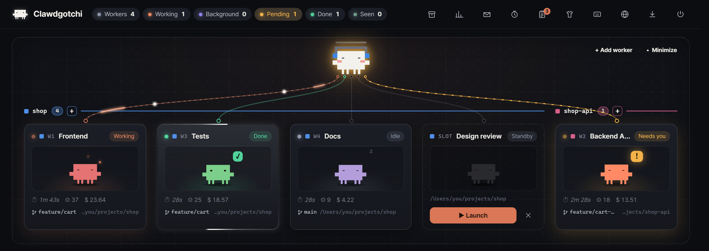
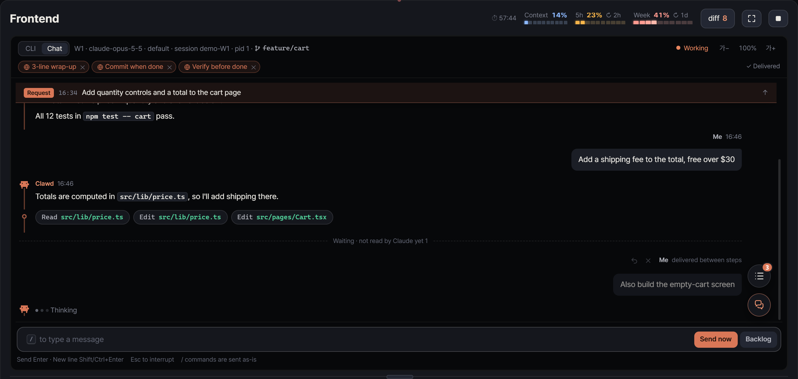
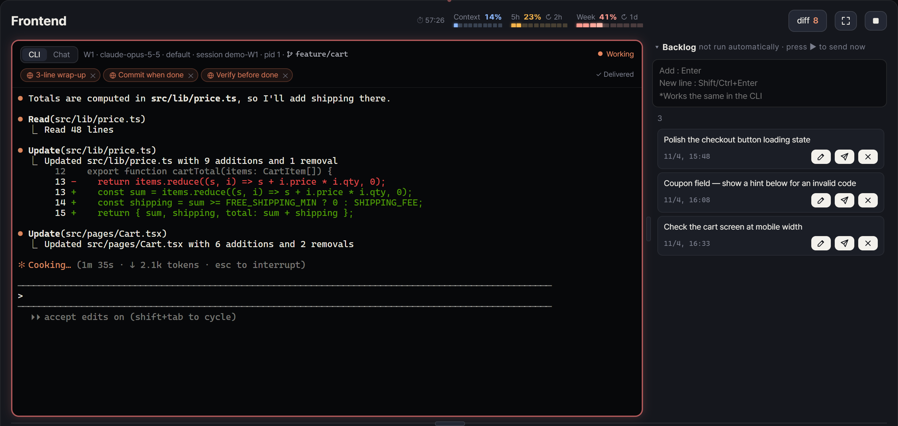
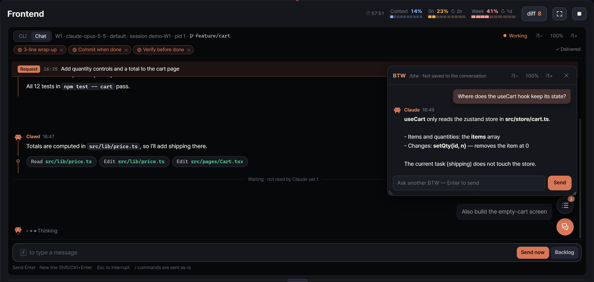
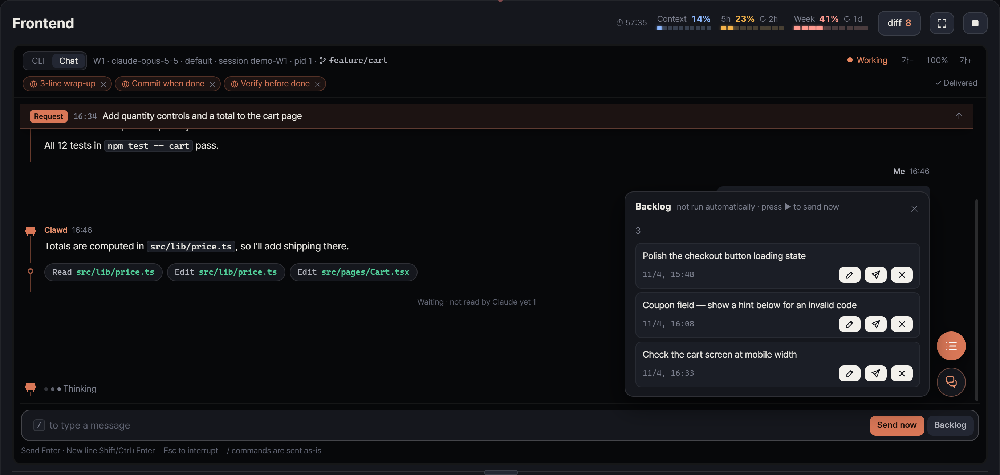
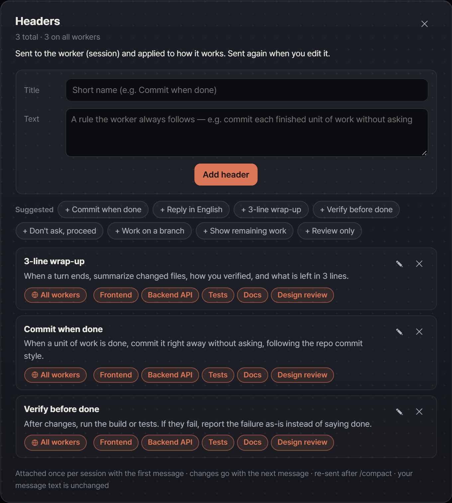
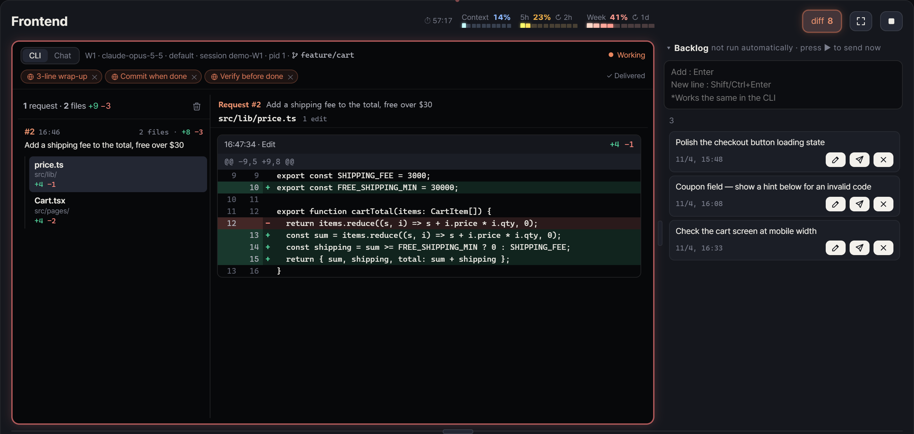
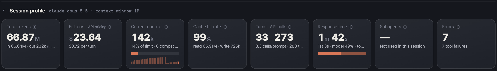
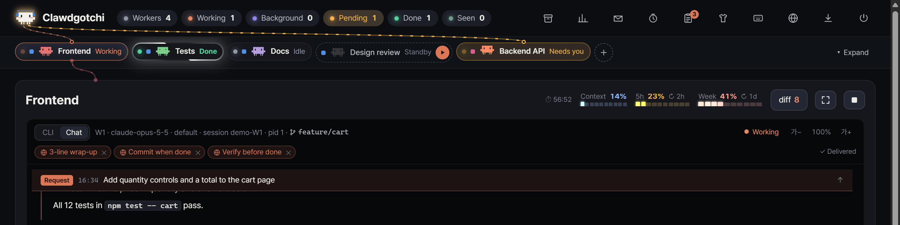

# Clawdgotchi (agent-manager)

**English** | [한국어](README.ko.md)

A dashboard that runs **several Claude Code sessions (workers) on your PC from one browser screen**.
Hand out work, follow it as a chat, and check what changed and what it cost.



- Workers are your usual `claude` CLI — same slash commands, skills, MCP, and settings.
- It listens on `127.0.0.1` only — **your PC only**. The only outbound call is the update check.
- Restarting the dashboard **does not kill workers**; it re-attaches to them.

## Install

Requirements: **Node.js 20+**, a signed-in **Claude Code CLI**, Windows 10/11 or macOS

```bash
git clone https://github.com/stzjinseong/agent-manager.git
```

Open `claude` in the cloned folder and type the command below — it checks everything and installs for you.

| | Install | Run |
|---|---|---|
| macOS | `/setup --mac` | `Launch.app`, or `agent-manager` in a terminal |
| Windows | `/setup --windows` | `Launch.vbs`, or `agent-manager` in PowerShell |

> If macOS shows a security warning the first time you open `Launch.app`, **right-click → Open** in Finder.

## At a glance

| | |
|---|---|
| **Worker cards** | Status (working · needs decision · done · idle), cost, git branch. Grouped by working folder (repo) |
| **Chat view** | Read and reply as a conversation instead of a terminal. Permission requests and questions become cards |
| **BTW** | Ask a side question (`/btw`) while Claude keeps working. The answer shows in its own window and is not saved to the conversation |
| **Backlog** | Park things for later and send them with one ▶. Drag them onto another worker to move them |
| **Headers** | Rules always attached for all workers (or chosen roles) — like "commit when done" |
| **diff** | Files a worker changed, per request — including changes from shell commands and subagents |
| **Usage · profile** | Context, 5-hour and weekly limit bars; tokens, estimated cost, cache hit rate, time per tool |

## How to use

### 1. Start a worker

Use **+ Add worker** at the top right: pick a role name and a working folder, then **Launch**.
For a folder you already use, the **+** on its group header launches a worker with just a model and permission mode.

- Roles are saved, so a closed worker's card stays in the **waiting room**. **▶ Launch** starts it again.
- Dragging a card shows drop zones below — **End session only** or **End session + remove card**.

### 2. Give work and watch — Chat / CLI

Click a card to open that worker below. Switch views with **CLI | Chat** at the top left.



- **Send now** sends right away. If Claude is busy, it goes in at the next gap between tools; until then it waits under the **Waiting · not read by Claude yet** line, where you can remove it or move it to Backlog.
- Permission requests appear at the end of the chat as an **Allow · Deny · Choose in CLI** card; questions appear as a card above the input. The worker card turns **needs decision** and the browser tab icon gets a dot.
- `/` autocompletes slash commands (the list comes from that worker's Claude Code), **↑** recalls messages sent in this session, **Esc** interrupts.
- Select text in a Claude answer to get **1 Ask · 2 Insert · 3 Copy** (number keys work too).
- Scrolling up pins your hidden request at the top; when you are not at the bottom, a **↓** button appears above the input.
- Images in answers (``) and documents/captures Claude made show as cards in place. **가− 100% 가+** sets the text size.
- When Claude Code shows a screen only the CLI can answer (menus like `/model`), the real terminal slides up under the chat with a **CLI is waiting for input** bar.

Switch to CLI for the plain Claude Code terminal.



### 3. Side questions while it works — BTW

Send `/btw your question` from the input, or click the **speech-bubble button** at the bottom right. Claude does not stop its work, and the answer appears in a separate **BTW window**.



- Ask follow-ups in the window's own input, drag the header to move it, drag a corner to resize. Text size with **가− 100% 가+**.
- BTW answers are not saved to the Claude Code conversation (visible within the same session only).

### 4. Later — Backlog

Add items with the **Backlog** button next to the chat input, or the input in the CLI view's right panel.
In the chat view, the **list button** above the BTW button (with a count) opens the Backlog.



- ▶ sends now, the pencil edits, ✕ deletes. Drag to reorder, or **drop onto another worker card** to move it there.
- Backlog never runs on its own — you choose when to send.

### 5. Rules that always apply — Headers

Write standing rules under 📋 **Headers** in the top bar. They apply to all workers or chosen roles,
and are attached once to the first message of each session (edits go with the next message). Attached headers show as chips under the Chat/CLI bar.



### 6. Review changes — diff

Click **diff** to see the changed files, per request.



### 7. Tokens · cost — usage bars · session profile

The bars at the top right of the detail show **context**, your account's **5-hour and weekly limits** with time to reset, and time until the cache expires.
The **session profile** below the worker shows total tokens, estimated cost, cache hit rate, and per-tool usage; hover **ⓘ** to learn what each metric means and how to use it.



### 8. Tidy up · customize

**▴ Minimize** folds the cards into a one-line chip row. Click a chip to open that worker.



Top bar icons:

| | |
|---|---|
| 🗃 Notice box | See past notifications again |
| 📊 My usage report | Your token and cost usage |
| ✉ Daily summary | The day's work on a single card |
| ⏱ Scheduled tasks | Send a role an instruction at a set time / weekday |
| 📋 Headers | Section 5 above |
| 👕 Customize | Character (upload your own art) · theme (default · glass) · font · CLI colors. [How to make a theme](themes/README.md) |
| ⌨ Send & new line keys | Swap what Enter and Shift/Ctrl+Enter do |
| 🌐 Language | 한국어 / English |
| ⬇ Updates | New versions of Clawdgotchi and Claude Code. For Claude Code, **Update now** runs `claude update` in a terminal |
| ⏻ Shut down server | Stop only the server (workers keep running) or the workers too |

## Good to know

| Where | Send | New line | Other |
|---|---|---|---|
| Chat input · BTW · Backlog | Enter | Shift/Ctrl + Enter | Esc interrupt · `/` commands · ↑ history |
| Terminal (CLI) | Enter | Shift/Ctrl + Enter | Ctrl+C: copies a selection, otherwise interrupts |

- Drop or paste files and images into the input or the terminal to attach them.
- Documents, captures, and attachments also collect in the **file tabs (Output · Capture · Input)** above the detail. ▾ folds them, 🗑 clears them.
- After an update, **↻ Restart now** — workers stay as they are.
- Only the dark look is available for now (light is being reworked).
- Costs are estimates at API prices. With a subscription, your actual bill differs.
- Built for Chrome. In other browsers a **⚠** appears in the header; click it to open in Chrome.
