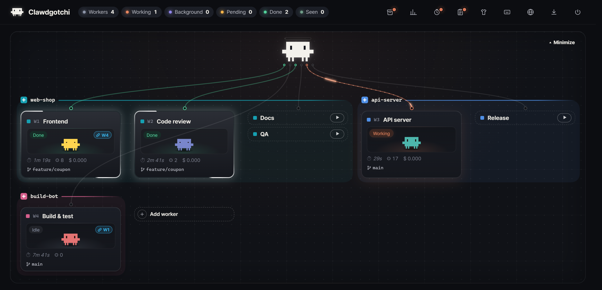
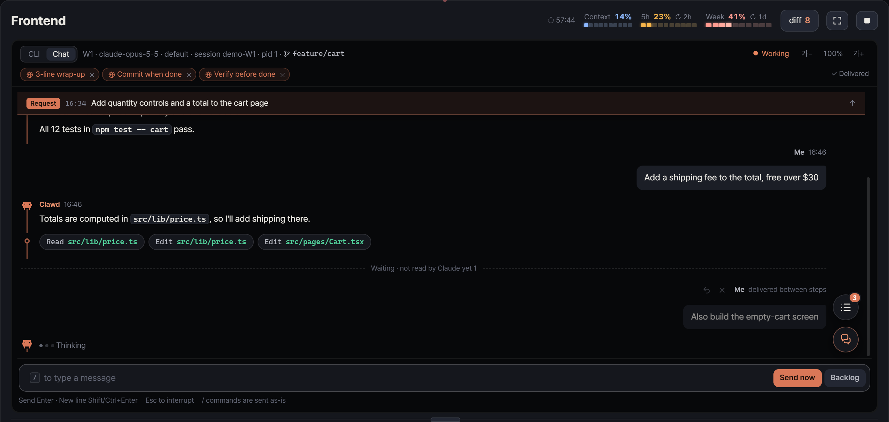
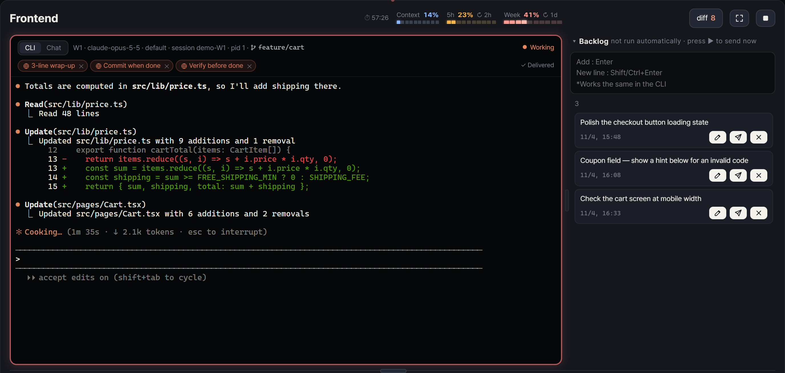
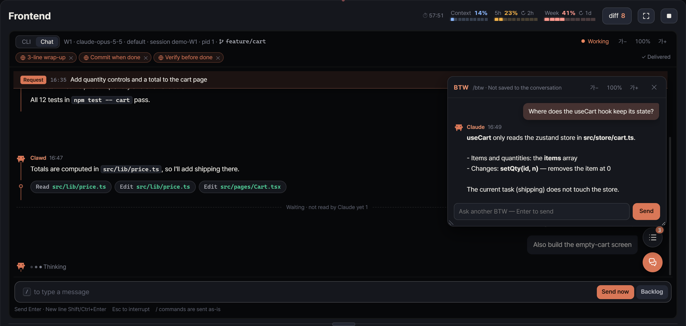
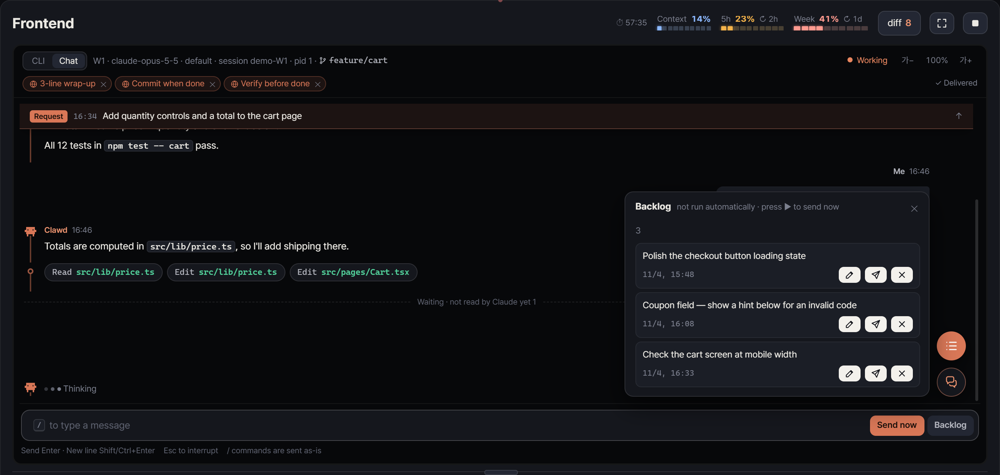
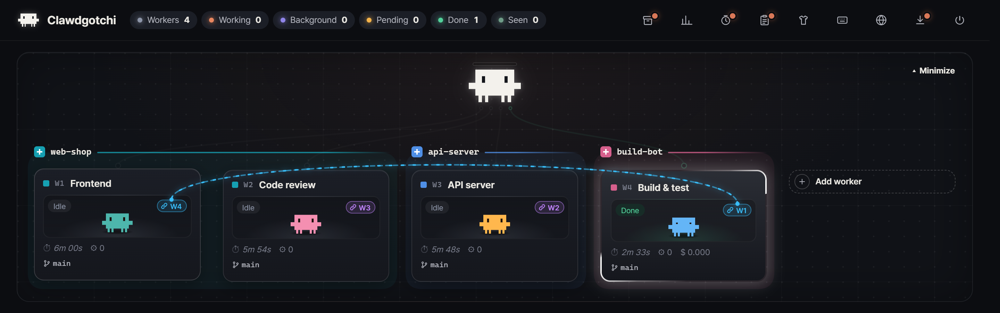
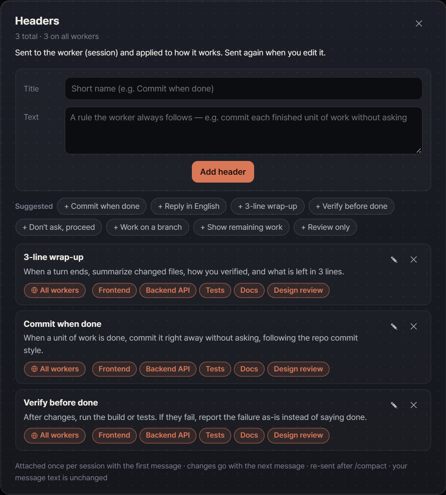
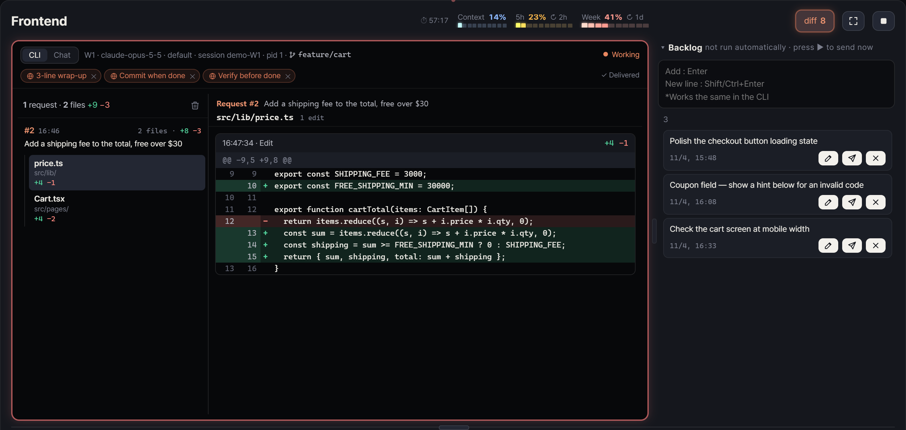
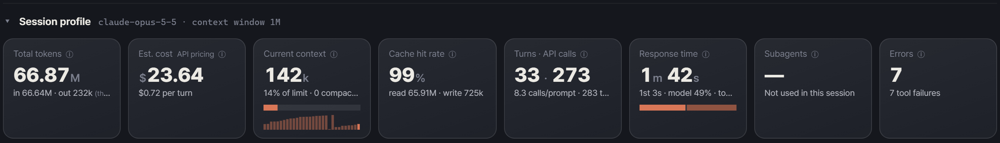
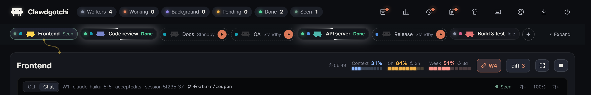

# Clawdgotchi (agent-manager)

**English** | [한국어](README.ko.md)

A dashboard that runs **several Claude Code sessions (workers) on your PC from one browser screen**.
Hand out work, follow it as a chat, and check what changed and what it cost. You can also link workers so they pass work to each other.



- Workers are your usual `claude` CLI — same slash commands, skills, MCP, and settings.
- It listens on `127.0.0.1` only — **your PC only**. The only outbound requests are the update check (GitHub · npm) and the UI font (CDN).
- Restarting the dashboard **does not kill workers**; it re-attaches to them. If you used **Shut down server + workers**, the workers that were running come back with their last session on the next start.

## Install

Requirements: **Node.js 20+**, a signed-in **Claude Code CLI**, Windows 10/11 or macOS

```bash
git clone https://github.com/stzjinseong/agent-manager.git
```

Open `claude` in the cloned folder and type the command below — it checks everything and installs for you.

| | Install | Run |
|---|---|---|
| macOS | `/setup --mac` | `Launch.app`, or `agent-manager` in a terminal |
| Windows | `/setup --windows` | `Launch.vbs`, or `agent-manager` in PowerShell |

> If macOS shows a security warning the first time you open `Launch.app`, **right-click → Open** in Finder.

## At a glance

| | |
|---|---|
| **Worker cards** | Status (working · needs decision · done · idle), cost, git branch. Boxed by working folder (repo) |
| **Chat view** | Read and reply as a conversation instead of a terminal. Permission requests, questions, and plan approvals become cards |
| **BTW** | Ask a side question (`/btw`) while Claude keeps working. The answer shows in its own window — which can pop out of the browser |
| **Backlog** | Park things for later and send them with one ▶, or pull one into the input with **↓** to edit before sending |
| **Linked workers 🔗** | Workers in different repos hand off tasks and send results back (e.g. W1 edits → W2 builds · tests → reports to W1) |
| **Headers** | Rules always attached for all workers (or chosen roles) — like "commit when done" |
| **diff** | Files a worker changed, per request — including shell commands and subagents. Click a tool chip in the chat to see just that edit |
| **Usage · profile** | Context, 5-hour and weekly limit bars; tokens, estimated cost, cache hit rate, time per tool |

## How to use

### 1. Reading the card board

The card board at the top is grouped into **boxes per working folder (repo)**. A box header has the repo color square · folder name · **+** (add a worker in that folder). When a group overflows a row, the next group fills the empty slots of its last row.

| Card | What's on it |
|---|---|
| **Worker card** | Header: number (W1) · role name · **⋯** menu<br>Stage: the character, a **status tag** at the top center (working · needs decision · done · idle — it also does the blinking), a **partner chip** (🔗 W2) at the top right, and thumbnails of the latest **capture** (bottom left) and **output document** (bottom right)<br>Bottom: ⏱ time this turn · ⚙ tool count · $ estimated cost, git branch |
| **Waiting room card** | A closed role. A one-line card with just the name and **▶ Launch**; four fit in one worker-card slot |
| **Add worker card** | A one-line card at the end of the list |

- A finished result you haven't checked makes the card border blink green until you open it.
- Folder paths are not shown on cards — the box header shows the folder, and hovering the card's bottom line shows the full path.
- Context usage lives in the detail panel's meter (section 9), not on the card.
- Double-click a chip name to rename the role; drag a card to reorder.

### 2. Start a worker

Use the **Add worker** card at the end of the card list: pick a role name, working folder, and permission mode, then **Launch**.
For a folder you already use, the **+** on its group box header launches a worker with just a model and permission mode.

- Roles are saved, so a closed worker stays as a one-line **waiting room** card. **▶ Launch** resumes the last session; **Shift + ▶** starts a new one.
- Dragging a card shows drop zones below — **End session only** or **End session + remove card**. Rename, reorder, and delete are also in the card's **⋯** menu.
- Records of finished workers are pruned automatically to the latest 3 per role (within 30 days).

### 3. Give work and watch — Chat / CLI

Click a card to open that worker below. It opens in **Chat** first; the **CLI | Chat** toggle at the top left switches each time you click it.



- **Send now** sends right away. If Claude is busy, it goes in at the next gap between tools; until then it waits under the **Waiting · not read by Claude yet** line, where you can remove it or move it to Backlog.
- Permission requests appear at the end of the chat as an **Allow · Deny · Choose in CLI** card; questions (AskUserQuestion) and plan approvals appear as cards above the input. The worker card turns **needs decision** and the browser tab icon gets a dot.
- While working, **what Claude is doing now** (its latest thinking) is shown. Background commands that keep running, like servers, are listed as **long-running processes**.
- Click a **tool chip** that edited a file (green outline) to open that edit's diff in a side panel.
- Input shortcuts: `/` autocompletes slash commands (from that worker's Claude Code) · **↑** messages sent in this session · **↓** take from Backlog · **Esc** interrupts (your message comes back to the input).
- Select text in a Claude answer to get **1 Ask · 2 Insert · 3 Copy** (number keys work too).
- Scrolling up pins your hidden request at the top; when you are not at the bottom, a **↓** button appears above the input.
- Images in answers (``) and documents/captures Claude made show as cards in place (even documents outside the working folder). **가− 100% 가+** sets the text size.
- When Claude Code shows a screen only the CLI can answer (the `/model` menu, the trust prompt for a new folder, …), the real terminal slides up under the chat with a **CLI is waiting for input** bar.
- When the hidden side has unsent text, its toggle glows softly — in the chat view, when text sits in the **CLI** input (rarely a sent message gets stuck there); in the CLI view, when the **Chat** input has a draft.

Switch to CLI for the plain Claude Code terminal.



### 4. Side questions while it works — BTW

Send `/btw your question` from the input, or click the **speech-bubble button** at the bottom right. Claude does not stop its work, and the answer appears in a separate **BTW window**.



- Ask follow-ups in the window's own input, drag the header to move it, drag a corner to resize. Text size with **가− 100% 가+**, **Esc** closes.
- The **pop out** button in the header turns it into a separate always-on-top window (Chrome · Edge). It follows you when you switch workers.
- Tables drawn by the CLI are shown as HTML tables.
- BTW answers are not saved to the Claude Code conversation (visible within the same session only).

### 5. Later — Backlog

Add items with the **Backlog** button next to the chat input, or the input in the CLI view's right panel.
In the chat view, the **list button** above the BTW button (with a count) opens the Backlog.



- ▶ sends now, the pencil edits, ✕ deletes. Drag to reorder, or **drop onto another worker card** to move it there.
- Press **↓** in the chat input to open the Backlog list; the item you pick is taken out and put into the input (below any text you were writing).
- Backlog never runs on its own — you choose when to send.

### 6. Workers handing off work — Linked workers 🔗

Pick a partner from the card's **⋯** menu → **🔗 Link worker…**.
Then tell a linked worker something like "have W2 build and test this" — it sends the task to its partner, which reports back when done.



- They can be in different repos — e.g. a client worker edits, and a worker in the build-machine repo pulls, builds, tests, and returns the result.
- The card gets a partner chip (🔗 W2); hovering draws a line to the partner, and a note flies between them when they exchange messages.
- Workers learn about a link from their next message. An exchange stops after **12** hops without a human message (no endless "got it").

### 7. Rules that always apply — Headers

Write standing rules under 📋 **Headers** in the top bar. They apply to all workers or chosen roles,
and are attached once to the first message of each session (edits go with the next message). Attached headers show as chips under the Chat/CLI bar.



### 8. Review changes — diff

Click **diff** to see the changed files, per request. **가− 100% 가+** (or Ctrl + wheel) sets the text size.



### 9. Tokens · cost — usage bars · session profile

The bars at the top right of the detail show **context**, your account's **5-hour and weekly limits** with time to reset, and time until the cache expires.
The **session profile** below the worker shows total tokens, estimated cost, cache hit rate, and per-tool usage; hover **ⓘ** to learn what each metric means and how to use it.



> Usage limits are read even on PCs where a managed (company) setting controls the status line — your original status line command still runs.

### 10. Tidy up · customize

**▴ Minimize** folds the cards into a one-line chip row. Click a chip to open that worker.



Top bar icons:

| | |
|---|---|
| 🗃 Notice box | See past notifications again |
| 📊 My usage report | Your token and cost usage (7 days · 30 days · all) |
| ✉ Daily summary | The day's work on a single card |
| ⏱ Scheduled tasks | Send a role an instruction once, daily, or at an interval. Skipped when the 5-hour limit is over 90% |
| 📋 Headers | Section 7 above |
| 👕 Customize | Character (upload your own art) · theme (default · glass · make your own) · font · CLI colors. [How to make a theme](themes/README.md) |
| ⌨ Send & new line keys | Swap what Enter and Shift/Ctrl+Enter do |
| 🌐 Language | 한국어 / English |
| ⬇ Updates | New versions of Clawdgotchi and Claude Code. For Claude Code, **Update now** runs `claude update` in a terminal |
| ⏻ Shut down server | Stop only the server (workers keep running) or the workers too (they come back on the next start) |

## Good to know

| Where | Send | New line | Other |
|---|---|---|---|
| Chat input · BTW · Backlog | Enter | Shift/Ctrl + Enter | Esc interrupt · `/` commands · ↑ history · ↓ Backlog |
| Terminal (CLI) | Enter | Shift/Ctrl + Enter | Ctrl+C: copies a selection, otherwise interrupts · Ctrl+X cut |

- Drop or paste files and images into the input or the terminal to attach them (20 MB per file, cleaned up after 7 days).
- Documents, captures, and attachments also collect in the **file tabs (Output · Capture · Input)** above the detail. ▾ folds them, 🗑 clears them.
- On phones and tablets, long-press a card for its menu; a key row (Esc · ^C · ⇧Tab · arrows) appears under the terminal.
- After an update, **↻ Restart now** — workers stay as they are.
- To stop every worker at once: `npm run stop-workers`.
- Only the dark look is available for now (light is being reworked).
- Costs are estimates at API prices. With a subscription, your actual bill differs.
- Built for Chrome. In other browsers a **⚠** appears in the header; click it to open in Chrome.

<details>
<summary>Advanced — environment variables</summary>

| Variable | Default | Meaning |
|---|---|---|
| `AM_PORT` | `7788` | Dashboard port |
| `AM_PTY_PORT` | `7787` | Port of the background process that holds worker terminals |
| `AM_DATA` | `<repo>/data` | Folder for roles, records, and attachments |
| `AM_THEMES` | `<repo>/themes` | User theme folder |
| `AM_CLAUDE` | (`claude` on PATH) | Path to the claude executable |
| `AM_LANG` | — | Launcher window and log language (`ko` / `en`) |
| `AM_REMOTE_DECISIONS` | — | `1` to approve permissions from the dashboard's top decision box |
| `AM_ALLOWED_HOSTS` | — | Extra allowed Host headers |
| `AM_DEBUG` | — | Log hooks to `data/hook-debug.jsonl` |

</details>
