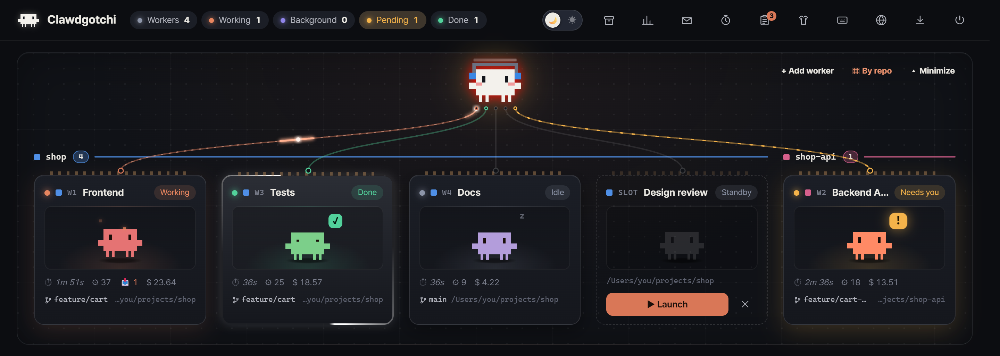
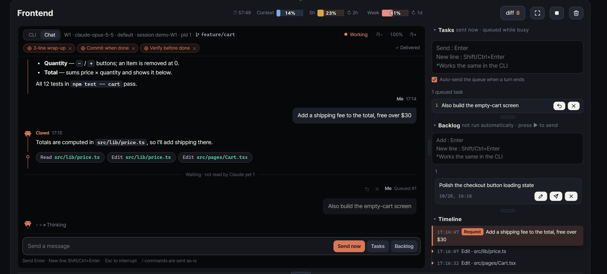
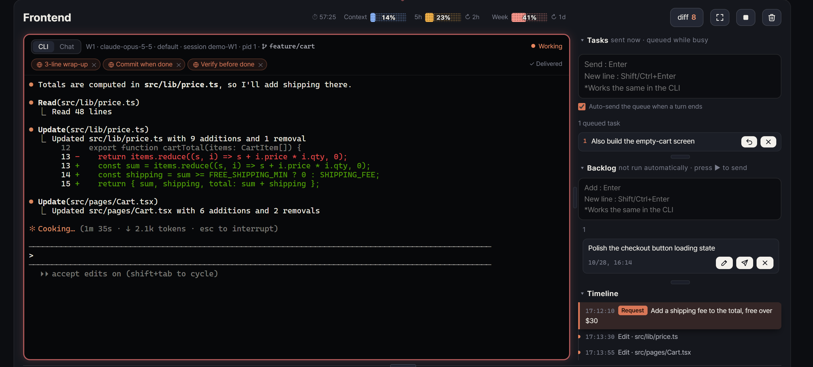
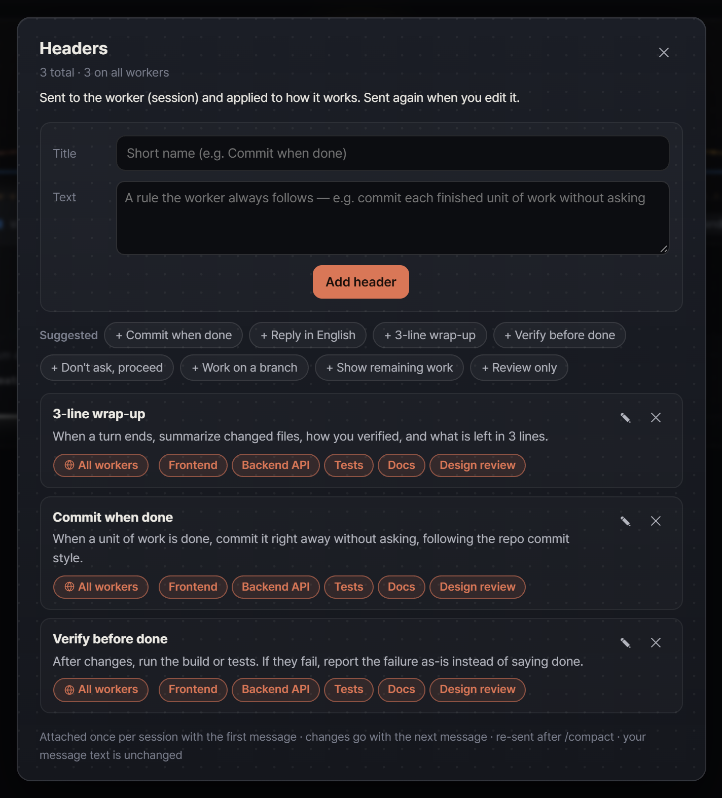
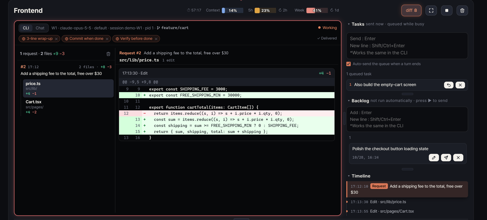
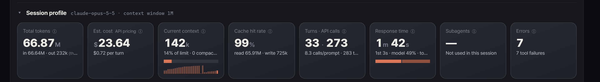
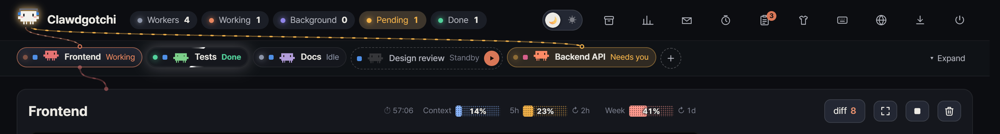

# Clawdgotchi (agent-manager)

**English** | [한국어](README.ko.md)

A dashboard for running **multiple Claude Code sessions (workers) on your PC from a single browser page**.
Hand out tasks, follow them as a chat, and review what they changed and what it cost.



- Each worker is the same `claude` CLI you already use — your slash commands, skills, MCP servers and settings all work as usual.
- A **local-only** tool listening on `127.0.0.1` only. The only outside connection is the update check.
- Restarting the dashboard **does not disconnect workers** — they reattach automatically.

## Installation

Requirements: **Node.js 20 or later**, a logged-in **Claude Code CLI**, Windows 10/11 or macOS

```bash
git clone https://github.com/stzjinseong/agent-manager.git
```

Open `claude` in the cloned folder and run the command below — it checks everything and installs for you.

| | Install | Run |
|---|---|---|
| macOS | `/setup --mac` | `Launch.app`, or `agent-manager` in a terminal |
| Windows | `/setup --windows` | `Launch.vbs`, or `agent-manager` in PowerShell |

> On macOS, if a security warning appears the first time you open `Launch.app`, **right-click → Open** it in Finder.

## At a glance

| | |
|---|---|
| **Worker cards** | Status (Working · Needs you · Done · Idle), cost and git branch, grouped by repo |
| **Chat view** | Read and reply as a conversation instead of a terminal. Questions and permission prompts show up as cards |
| **Tasks · Backlog** | Tasks are sent now (queued while busy); Backlog holds ideas for later |
| **Headers** | Rules sent to every worker (or chosen roles) — e.g. "Commit when done" |
| **diff** | Files a worker changed, per request — including shell commands and subagents |
| **Session profile** | Tokens · estimated cost · context · cache hit rate · time per tool |

## Usage

### 1. Launch a worker

Click the **Add worker** card at the end of the card row, set a role name and working folder, then **Launch**.
With **Save role** on, the card stays in **Standby** after the worker closes, so you can bring it back with **▶ Launch**.

### 2. Give work and follow along — Chat / CLI

Click a card to open that worker below. Switch views with **CLI | Chat** at the top left.



- **Send now** sends right away (while busy, it goes in when the current tool finishes), **Tasks** queues it, **Backlog** saves it as a note.
- Messages Claude hasn't read yet sit dimmed under the **Waiting** line — you can remove them or move them to Backlog.
- When Claude finishes, **✓ Done** appears at the end of the conversation. Press **Esc** to interrupt anytime.
- `/` autocompletes slash commands, **↑** brings back what you sent.

Switch to CLI for the regular Claude Code terminal.



When a permission prompt comes up, the card turns **Needs you** and the browser tab icon gets a dot.

### 3. Always-on rules — Headers

Write rules your workers should always follow in 📋 **Headers** at the top. Each one applies to all workers or only to chosen roles,
and is attached once per session with the first message (edits go with the next message). Attached headers show as chips under the CLI/Chat bar.



### 4. Review changes — diff

Click **diff** to see changed files, grouped by request.



### 5. Tokens and cost — Session profile

The **Session profile** under the worker shows total tokens, estimated cost, context, cache hit rate and per-tool usage.
Hover **ⓘ** for what each metric means and how to use it. The bar above the worker shows time left until the cache expires and your account's 5-hour and weekly limits.



### 6. Tidy up and customize

**▴ Minimize** folds the cards into a single row of chips. Click a chip to open that worker.



- 👕 **Customize** — characters (upload your own), themes, fonts and CLI colors. [How to make a theme](themes/README.md)
- ⏱ **Schedule** — send instructions to a role at set times and days.
- 📊 **Usage report** · 🌐 English/한국어 · 🌙/☀ dark/light · ⬇ update alerts

## Good to know

| Where | Send | New line | Other |
|---|---|---|---|
| Chat input · Tasks · Backlog | Enter | Shift/Ctrl + Enter | Esc to interrupt · `/` commands · ↑ history |
| Terminal (CLI) | Enter | Shift/Ctrl + Enter | Ctrl+C: copies the selection if any, otherwise interrupts |

- Drag files or images onto the input or terminal, or paste them, to attach.
- **⏻** stops just the server (workers keep running) or the workers too. After an update, click **↻ Restart now** — workers stay as they are.
- Costs are estimates at API prices. On a subscription, your actual bill differs.
- Built for Chrome. In other browsers a **⚠** appears in the header; click it to open in Chrome.
